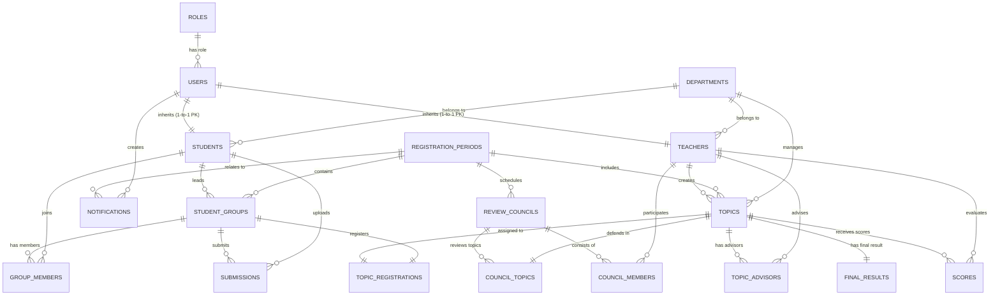

# SƠ ĐỒ VÀ THIẾT KẾ CƠ SỞ DỮ LIỆU
## HỆ THỐNG QUẢN LÝ ĐỀ TÀI (TOPIC MANAGEMENT SYSTEM)

Tài liệu này ghi lại chi tiết thiết kế Cơ sở dữ liệu (Database Schema), sơ đồ quan hệ thực thể (ERD), cùng cấu trúc chi tiết các bảng, khóa chính, khóa ngoại, ràng buộc và mô tả các trường cho dự án **Topic Management System**.

---

## 1. SƠ ĐỒ QUAN HỆ THỰC THỂ (ERD - ENTITY RELATIONSHIP DIAGRAM)

---

## 2. DANH SÁCH BẢNG & CHI TIẾT CẤU TRÚC (TABLE SPECIFICATIONS)

Hệ thống bao gồm **18 bảng** dữ liệu:

### 2.1. Bảng `roles` (Vai trò hệ thống)
Lưu giữ thông tin phân quyền của hệ thống.
* **Tên bảng trong DB:** `roles`

| Tên trường | Kiểu dữ liệu | Ràng buộc | Mô tả |
| :--- | :--- | :--- | :--- |
| `id` | BIGINT | PRIMARY KEY, AUTO_INCREMENT | Mã định danh duy nhất của vai trò |
| `name` | VARCHAR(30) | UNIQUE, NOT NULL | Tên vai trò (`ROLE_ADMIN`, `ROLE_HEAD_OF_DEPARTMENT`, `ROLE_TEACHER`, `ROLE_STUDENT`) |

---

### 2.2. Bảng `users` (Tài khoản người dùng)
Lưu thông tin đăng nhập và thông tin cá nhân cơ bản của tất cả người dùng trong hệ thống.
* **Tên bảng trong DB:** `users`

| Tên trường | Kiểu dữ liệu | Ràng buộc | Mô tả |
| :--- | :--- | :--- | :--- |
| `id` | BIGINT | PRIMARY KEY, AUTO_INCREMENT | Mã tài khoản người dùng |
| `username` | VARCHAR(50) | UNIQUE, NOT NULL | Tên đăng nhập |
| `password` | VARCHAR(255) | NOT NULL | Mật khẩu đã được mã hóa (BCrypt) |
| `full_name` | VARCHAR(100) | NOT NULL | Họ và tên người dùng |
| `email` | VARCHAR(100) | UNIQUE, NOT NULL | Địa chỉ Email |
| `phone` | VARCHAR(20) | NULL | Số điện thoại liên hệ |
| `enabled` | BOOLEAN | NOT NULL, DEFAULT true | Trạng thái tài khoản (kích hoạt / khóa) |
| `role_id` | BIGINT | FK -> `roles(id)`, NOT NULL | Mã vai trò của tài khoản |
| `created_at` | DATETIME | NOT NULL | Thời gian tạo tài khoản |

---

### 2.3. Bảng `departments` (Bộ môn / Khoa)
Quản lý danh mục các Bộ môn/Bộ phận thuộc Khoa.
* **Tên bảng trong DB:** `departments`

| Tên trường | Kiểu dữ liệu | Ràng buộc | Mô tả |
| :--- | :--- | :--- | :--- |
| `id` | BIGINT | PRIMARY KEY, AUTO_INCREMENT | Mã bộ môn |
| `code` | VARCHAR(20) | UNIQUE, NOT NULL | Mã định danh bộ môn (Ví dụ: `CNTT`, `HTTH`, `KHMT`) |
| `name` | VARCHAR(100) | NOT NULL | Tên đầy đủ của bộ môn |
| `description` | TEXT | NULL | Mô tả thêm về bộ môn |
| `created_at` | DATETIME | NOT NULL | Thời điểm tạo bộ môn |

---

### 2.4. Bảng `students` (Sinh viên)
Thông tin hồ sơ sinh viên, kế thừa từ thông tin tài khoản người dùng (`users`).
* **Tên bảng trong DB:** `students`

| Tên trường | Kiểu dữ liệu | Ràng buộc | Mô tả |
| :--- | :--- | :--- | :--- |
| `id` | BIGINT | PRIMARY KEY, FK -> `users(id)` | Mã sinh viên (Dùng chung PK với `users.id`) |
| `student_code` | VARCHAR(20) | UNIQUE, NOT NULL | Mã số sinh viên (MSSV) |
| `class_name` | VARCHAR(50) | NOT NULL | Tên lớp sinh hoạt (Ví dụ: `DHCNTT17A`) |
| `academic_year` | VARCHAR(20) | NULL | Niên khóa (Ví dụ: `2021-2025`) |
| `department_id` | BIGINT | FK -> `departments(id)`, NOT NULL | Mã bộ môn trực thuộc |

---

### 2.5. Bảng `teachers` (Giảng viên)
Thông tin hồ sơ giảng viên, kế thừa từ thông tin tài khoản người dùng (`users`).
* **Tên bảng trong DB:** `teachers`

| Tên trường | Kiểu dữ liệu | Ràng buộc | Mô tả |
| :--- | :--- | :--- | :--- |
| `id` | BIGINT | PRIMARY KEY, FK -> `users(id)` | Mã giảng viên (Dùng chung PK với `users.id`) |
| `teacher_code` | VARCHAR(20) | UNIQUE, NOT NULL | Mã số giảng viên (MSGV) |
| `academic_rank` | VARCHAR(50) | NULL | Học hàm (GS, PGS, TS, ...) |
| `degree` | VARCHAR(50) | NULL | Học vị (ThS, TS, Kỹ sư, ...) |
| `department_id` | BIGINT | FK -> `departments(id)`, NOT NULL | Mã bộ môn giảng viên công tác |

---

### 2.6. Bảng `registration_periods` (Đợt đăng ký)
Quản lý các đợt đăng ký đề tài (Tiểu luận, Niên luận, Khóa luận tốt nghiệp).
* **Tên bảng trong DB:** `registration_periods`

| Tên trường | Kiểu dữ liệu | Ràng buộc | Mô tả |
| :--- | :--- | :--- | :--- |
| `id` | BIGINT | PRIMARY KEY, AUTO_INCREMENT | Mã đợt đăng ký |
| `name` | VARCHAR(150) | NOT NULL | Tên đợt đăng ký (Ví dụ: `Đợt KLTN Học kỳ 1 2024-2025`) |
| `period_type` | VARCHAR(20) | NOT NULL | Loại đợt (`TIEN_LUAN`, `KHAN_LUAN`, `MON_HOC`, ...) |
| `teacher_start_date` | DATETIME | NOT NULL | Bắt đầu thời gian GV đề xuất đề tài |
| `teacher_end_date` | DATETIME | NOT NULL | Kết thúc thời gian GV đề xuất đề tài |
| `student_start_date` | DATETIME | NOT NULL | Bắt đầu thời gian SV đăng ký đề tài |
| `student_end_date` | DATETIME | NOT NULL | Kết thúc thời gian SV đăng ký đề tài |
| `review_submission_deadline` | DATETIME | NULL | Hạn nộp báo cáo / tài liệu phản biện |
| `council_report_date` | DATETIME | NULL | Ngày báo cáo trước hội đồng |
| `status` | VARCHAR(30) | NOT NULL, DEFAULT 'DRAFT' | Trạng thái đợt (`DRAFT`, `OPEN`, `STUDENT_REGISTRATION`, `CLOSED`, ...) |
| `created_at` | DATETIME | NOT NULL | Ngày tạo đợt |

---

### 2.7. Bảng `student_groups` (Nhóm sinh viên)
Quản lý thông tin nhóm sinh viên thực hiện đề tài trong một đợt đăng ký.
* **Tên bảng trong DB:** `student_groups`

| Tên trường | Kiểu dữ liệu | Ràng buộc | Mô tả |
| :--- | :--- | :--- | :--- |
| `id` | BIGINT | PRIMARY KEY, AUTO_INCREMENT | Mã nhóm |
| `group_code` | VARCHAR(30) | NOT NULL | Mã nhóm sinh viên (Ví dụ: `GRP-2024-001`) |
| `period_id` | BIGINT | FK -> `registration_periods(id)`, NOT NULL | Đợt đăng ký thuộc về |
| `leader_student_id` | BIGINT | FK -> `students(id)`, NOT NULL | Mã sinh viên làm trưởng nhóm |
| `status` | VARCHAR(30) | NOT NULL, DEFAULT 'FORMING' | Trạng thái nhóm (`FORMING`, `COMPLETE`, `DISBANDED`) |
| `created_at` | DATETIME | NOT NULL | Thời điểm lập nhóm |

---

### 2.8. Bảng `group_members` (Thành viên nhóm sinh viên)
Liên kết các sinh viên vào nhóm sinh viên.
* **Tên bảng trong DB:** `group_members`
* **Ràng buộc duy nhất:** `UNIQUE (group_id, student_id)`

| Tên trường | Kiểu dữ liệu | Ràng buộc | Mô tả |
| :--- | :--- | :--- | :--- |
| `id` | BIGINT | PRIMARY KEY, AUTO_INCREMENT | Mã dòng liên kết thành viên |
| `group_id` | BIGINT | FK -> `student_groups(id)`, NOT NULL | Mã nhóm sinh viên |
| `student_id` | BIGINT | FK -> `students(id)`, NOT NULL | Mã sinh viên tham gia |
| `joined_at` | DATETIME | NOT NULL | Thời điểm tham gia nhóm |

---

### 2.9. Bảng `topics` (Đề tài)
Quản lý thông tin chi tiết các đề tài nghiên cứu/đồ án được đề xuất.
* **Tên bảng trong DB:** `topics`

| Tên trường | Kiểu dữ liệu | Ràng buộc | Mô tả |
| :--- | :--- | :--- | :--- |
| `id` | BIGINT | PRIMARY KEY, AUTO_INCREMENT | Mã đề tài |
| `title` | VARCHAR(255) | NOT NULL | Tên đề tài |
| `description` | TEXT | NOT NULL | Mô tả chi tiết mục tiêu, nội dung đề tài |
| `requirements` | TEXT | NULL | Yêu cầu đối với sinh viên thực hiện |
| `department_id` | BIGINT | FK -> `departments(id)`, NOT NULL | Bộ môn quản lý đề tài |
| `period_id` | BIGINT | FK -> `registration_periods(id)`, NOT NULL | Đợt đăng ký áp dụng đề tài |
| `status` | VARCHAR(30) | NOT NULL, DEFAULT 'PENDING_APPROVAL' | Trạng thái đề tài (`PENDING_APPROVAL`, `APPROVED`, `REJECTED`, `REGISTERED`) |
| `created_by_teacher_id` | BIGINT | FK -> `teachers(id)`, NOT NULL | Giảng viên tạo đề tài |
| `created_at` | DATETIME | NOT NULL | Ngày tạo đề tài |

---

### 2.10. Bảng `topic_advisors` (Giảng viên hướng dẫn / phản biện đề tài)
Quản lý danh sách giảng viên hướng dẫn hoặc phản biện cho từng đề tài.
* **Tên bảng trong DB:** `topic_advisors`
* **Ràng buộc duy nhất:** `UNIQUE (topic_id, teacher_id)`

| Tên trường | Kiểu dữ liệu | Ràng buộc | Mô tả |
| :--- | :--- | :--- | :--- |
| `id` | BIGINT | PRIMARY KEY, AUTO_INCREMENT | Mã dòng hướng dẫn |
| `topic_id` | BIGINT | FK -> `topics(id)`, NOT NULL | Mã đề tài |
| `teacher_id` | BIGINT | FK -> `teachers(id)`, NOT NULL | Mã giảng viên |
| `advisor_role` | VARCHAR(20) | NOT NULL, DEFAULT 'PRIMARY' | Vai trò hướng dẫn (`PRIMARY`, `CO_ADVISOR`, `CRITIC`) |

---

### 2.11. Bảng `topic_registrations` (Đăng ký đề tài của nhóm)
Lưu vết việc đăng ký giữa Nhóm sinh viên và Đề tài. Quan hệ 1-1 (Mỗi nhóm chỉ đăng ký 1 đề tài và mỗi đề tài chỉ được 1 nhóm đăng ký thành công).
* **Tên bảng trong DB:** `topic_registrations`

| Tên trường | Kiểu dữ liệu | Ràng buộc | Mô tả |
| :--- | :--- | :--- | :--- |
| `id` | BIGINT | PRIMARY KEY, AUTO_INCREMENT | Mã bản ghi đăng ký |
| `group_id` | BIGINT | UNIQUE, FK -> `student_groups(id)`, NOT NULL | Mã nhóm đăng ký |
| `topic_id` | BIGINT | UNIQUE, FK -> `topics(id)`, NOT NULL | Mã đề tài được đăng ký |
| `status` | VARCHAR(30) | NOT NULL, DEFAULT 'PENDING' | Trạng thái duyệt đăng ký (`PENDING`, `APPROVED`, `REJECTED`) |
| `rejection_reason` | TEXT | NULL | Lý do từ chối (nếu bị từ chối) |
| `registered_at` | DATETIME | NOT NULL | Thời điểm gửi đăng ký |

---

### 2.12. Bảng `review_councils` (Hội đồng đánh giá / phản biện)
Quản lý các hội đồng chấm bảo vệ đề tài.
* **Tên bảng trong DB:** `review_councils`

| Tên trường | Kiểu dữ liệu | Ràng buộc | Mô tả |
| :--- | :--- | :--- | :--- |
| `id` | BIGINT | PRIMARY KEY, AUTO_INCREMENT | Mã hội đồng |
| `council_code` | VARCHAR(30) | UNIQUE, NOT NULL | Mã định danh hội đồng (Ví dụ: `HDCB-2024-01`) |
| `name` | VARCHAR(150) | NOT NULL | Tên hội đồng (Ví dụ: `Hội đồng chấm KLTN Bộ môn CNTT 1`) |
| `period_id` | BIGINT | FK -> `registration_periods(id)`, NOT NULL | Đợt đăng ký thuộc về |
| `defense_date` | DATETIME | NULL | Ngày giờ tổ chức chấm bảo vệ |
| `location` | VARCHAR(150) | NULL | Địa điểm / Phòng máy (Ví dụ: `Phòng A.302`) |
| `created_at` | DATETIME | NOT NULL | Thời điểm lập hội đồng |

---

### 2.13. Bảng `council_members` (Thành viên hội đồng)
Phân công các giảng viên vào thành phần hội đồng chấm đề tài.
* **Tên bảng trong DB:** `council_members`
* **Ràng buộc duy nhất:** `UNIQUE (council_id, teacher_id)`

| Tên trường | Kiểu dữ liệu | Ràng buộc | Mô tả |
| :--- | :--- | :--- | :--- |
| `id` | BIGINT | PRIMARY KEY, AUTO_INCREMENT | Mã dòng thành viên hội đồng |
| `council_id` | BIGINT | FK -> `review_councils(id)`, NOT NULL | Mã hội đồng |
| `teacher_id` | BIGINT | FK -> `teachers(id)`, NOT NULL | Mã giảng viên tham gia |
| `role` | VARCHAR(20) | NOT NULL, DEFAULT 'MEMBER' | Chức danh trong hội đồng (`CHAIRMAN`, `SECRETARY`, `CRITIC`, `MEMBER`) |

---

### 2.14. Bảng `council_topics` (Đề tài thuộc hội đồng)
Gán các đề tài cho một hội đồng cụ thể chấm điểm. Quan hệ 1-1 đối với `topic_id`.
* **Tên bảng trong DB:** `council_topics`

| Tên trường | Kiểu dữ liệu | Ràng buộc | Mô tả |
| :--- | :--- | :--- | :--- |
| `id` | BIGINT | PRIMARY KEY, AUTO_INCREMENT | Mã dòng phân công hội đồng |
| `council_id` | BIGINT | FK -> `review_councils(id)`, NOT NULL | Mã hội đồng |
| `topic_id` | BIGINT | UNIQUE, FK -> `topics(id)`, NOT NULL | Mã đề tài được gán cho hội đồng |

---

### 2.15. Bảng `submissions` (Báo cáo / Nộp bài làm)
Quản lý các tệp tài liệu, báo cáo tiến độ / báo cáo cuối kỳ do sinh viên tải lên.
* **Tên bảng trong DB:** `submissions`

| Tên trường | Kiểu dữ liệu | Ràng buộc | Mô tả |
| :--- | :--- | :--- | :--- |
| `id` | BIGINT | PRIMARY KEY, AUTO_INCREMENT | Mã lượt nộp bài |
| `group_id` | BIGINT | FK -> `student_groups(id)`, NOT NULL | Nhóm sinh viên thực hiện nộp |
| `file_name` | VARCHAR(255) | NOT NULL | Tên gốc của tệp tin |
| `file_path` | VARCHAR(500) | NOT NULL | Đường dẫn lưu trữ tệp tin trên hệ thống |
| `file_size` | BIGINT | NOT NULL | Kích thước tệp (tính theo Bytes) |
| `version_number` | INT | NOT NULL, DEFAULT 1 | Lần nộp / Số phiên bản tệp nộp |
| `uploaded_by_student_id` | BIGINT | FK -> `students(id)`, NOT NULL | Mã sinh viên thực hiện tải lên |
| `notes` | TEXT | NULL | Ghi chú / Nhận xét kèm theo khi nộp |
| `uploaded_at` | DATETIME | NOT NULL | Thời điểm tải lên |

---

### 2.16. Bảng `scores` (Điểm chi tiết của từng giảng viên)
Lưu vết điểm số chi tiết do từng giảng viên chấm cho từng đề tài.
* **Tên bảng trong DB:** `scores`
* **Ràng buộc duy nhất:** `UNIQUE (topic_id, teacher_id)`

| Tên trường | Kiểu dữ liệu | Ràng buộc | Mô tả |
| :--- | :--- | :--- | :--- |
| `id` | BIGINT | PRIMARY KEY, AUTO_INCREMENT | Mã bản ghi điểm |
| `topic_id` | BIGINT | FK -> `topics(id)`, NOT NULL | Đề tài được chấm điểm |
| `teacher_id` | BIGINT | FK -> `teachers(id)`, NOT NULL | Giảng viên thực hiện chấm điểm |
| `score_value` | DECIMAL(4,2) | NOT NULL | Điểm số (Thang điểm 10.00) |
| `comments` | TEXT | NULL | Lời nhận xét / Đánh giá của giảng viên |
| `scored_at` | DATETIME | NOT NULL | Thời điểm chấm điểm |

---

### 2.17. Bảng `final_results` (Kết quả tổng kết đề tài)
Kết quả đánh giá tổng kết cuối cùng của đề tài sau khi tổng hợp điểm và ý kiến của Chủ tịch hội đồng.
* **Tên bảng trong DB:** `final_results`

| Tên trường | Kiểu dữ liệu | Ràng buộc | Mô tả |
| :--- | :--- | :--- | :--- |
| `id` | BIGINT | PRIMARY KEY, AUTO_INCREMENT | Mã bản ghi kết quả |
| `topic_id` | BIGINT | UNIQUE, FK -> `topics(id)`, NOT NULL | Mã đề tài (1-1) |
| `final_score` | DECIMAL(4,2) | NULL | Điểm số tổng kết trung bình |
| `evaluation_status` | VARCHAR(20) | NULL | Đạt / Không đạt (`PASSED`, `FAILED`, `PENDING`) |
| `chairman_comments` | TEXT | NULL | Đánh giá tổng hợp từ Chủ tịch hội đồng |
| `is_published` | BOOLEAN | NOT NULL, DEFAULT false | Đã công bố kết quả cho sinh viên chưa |
| `published_at` | DATETIME | NULL | Thời điểm công bố kết quả |

---

### 2.18. Bảng `notifications` (Thông báo hệ thống)
Quản lý các thông báo tin tức, đợt đăng ký, hoặc nhắc nhở nộp bài.
* **Tên bảng trong DB:** `notifications`

| Tên trường | Kiểu dữ liệu | Ràng buộc | Mô tả |
| :--- | :--- | :--- | :--- |
| `id` | BIGINT | PRIMARY KEY, AUTO_INCREMENT | Mã thông báo |
| `title` | VARCHAR(200) | NOT NULL | Tiêu đề thông báo |
| `content` | TEXT | NOT NULL | Nội dung thông báo chi tiết |
| `type` | VARCHAR(30) | NOT NULL | Loại thông báo (Enum `NotificationType`) |
| `target_role` | VARCHAR(30) | NULL | Đối tượng nhận (`ALL`, `ROLE_TEACHER`, `ROLE_STUDENT`) |
| `period_id` | BIGINT | FK -> `registration_periods(id)`, NULL | Đợt đăng ký liên quan (nếu có) |
| `created_by_user_id` | BIGINT | FK -> `users(id)`, NOT NULL | Người tạo thông báo |
| `created_at` | DATETIME | NOT NULL | Thời điểm tạo thông báo |

---

## 3. DANH MỤC CÁC LOẠI DỮ LIỆU LIỆT KÊ (ENUMS DATA DICTIONARY)

Các giá trị Enum được sử dụng đồng bộ trong hệ thống:

1. **`RoleName`**: `ROLE_ADMIN`, `ROLE_HEAD_OF_DEPARTMENT`, `ROLE_TEACHER`, `ROLE_STUDENT`
2. **`PeriodType`**: `TIEN_LUAN`, `KHAN_LUAN`, `MON_HOC`, `TIEU_LUAN`
3. **`PeriodStatus`**: `DRAFT`, `OPEN`, `STUDENT_REGISTRATION`, `CLOSED`, `COMPLETED`
4. **`StudentGroupStatus`**: `FORMING`, `COMPLETE`, `DISBANDED`
5. **`TopicStatus`**: `PENDING_APPROVAL`, `APPROVED`, `REJECTED`, `REGISTERED`
6. **`AdvisorRole`**: `PRIMARY`, `CO_ADVISOR`, `CRITIC`
7. **`TopicRegistrationStatus`**: `PENDING`, `APPROVED`, `REJECTED`
8. **`CouncilRole`**: `CHAIRMAN`, `SECRETARY`, `CRITIC`, `MEMBER`
9. **`EvaluationStatus`**: `PASSED`, `FAILED`, `PENDING`
10. **`NotificationType`**: `SYSTEM_ANNOUNCEMENT`, `PERIOD_NOTIFICATION`, `DEADLINE_REMINDER`, `TOPIC_STATUS_UPDATE`

---

## 4. TỔNG HỢP CÁC QUAN HỆ CHÍNH GIỮA CÁC BẢNG (RELATIONSHIP SUMMARY)

1. **`users` - `roles`**: Nhiều - 1 (`users.role_id` -> `roles.id`)
2. **`students` - `users`**: 1 - 1 (`students.id` -> `users.id` chia sẻ chung Primary Key qua `@MapsId`)
3. **`teachers` - `users`**: 1 - 1 (`teachers.id` -> `users.id` chia sẻ chung Primary Key qua `@MapsId`)
4. **`students` / `teachers` - `departments`**: Nhiều - 1 (`department_id`)
5. **`topics` - `teachers`**: Nhiều - 1 (`created_by_teacher_id`)
6. **`topics` - `departments`**: Nhiều - 1 (`department_id`)
7. **`topics` - `registration_periods`**: Nhiều - 1 (`period_id`)
8. **`topic_advisors` - `topics` / `teachers`**: Bảng trung gian Nhiều - Nhiều giữa Đề tài và Giảng viên hướng dẫn
9. **`student_groups` - `registration_periods`**: Nhiều - 1 (`period_id`)
10. **`student_groups` - `students`**: Nhiều - 1 (`leader_student_id` làm Trưởng nhóm)
11. **`group_members` - `student_groups` / `students`**: Bảng trung gian Nhiều - Nhiều liên kết Sinh viên vào Nhóm
12. **`topic_registrations` - `student_groups` / `topics`**: 1 - 1 giữa Nhóm sinh viên và Đề tài được đăng ký thành công
13. **`review_councils` - `registration_periods`**: Nhiều - 1 (`period_id`)
14. **`council_members` - `review_councils` / `teachers`**: Bảng trung gian Nhiều - Nhiều liên kết Giảng viên vào Hội đồng
15. **`council_topics` - `review_councils` / `topics`**: Liên kết 1 Đề tài vào 1 Hội đồng chấm bảo vệ
16. **`submissions` - `student_groups` / `students`**: Nhiều - 1 (Nhóm nộp bài & sinh viên tải lên)
17. **`scores` - `topics` / `teachers`**: Điểm chi tiết cho từng Đề tài bởi từng Giảng viên
18. **`final_results` - `topics`**: 1 - 1 (Kết quả điểm tổng kết cuối cùng của Đề tài)
19. **`notifications` - `users` / `registration_periods`**: Quản lý thông báo được gửi bởi User
